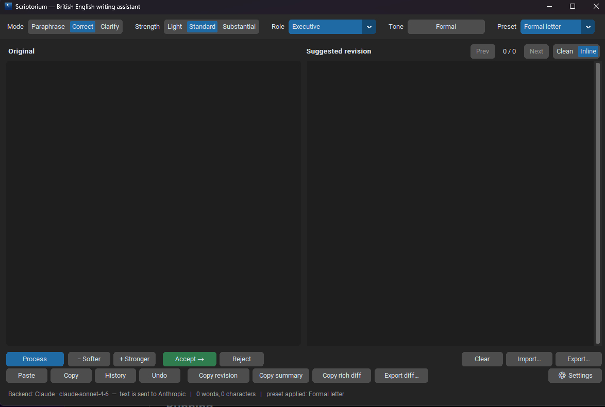
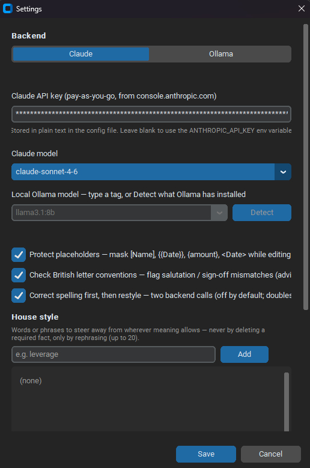
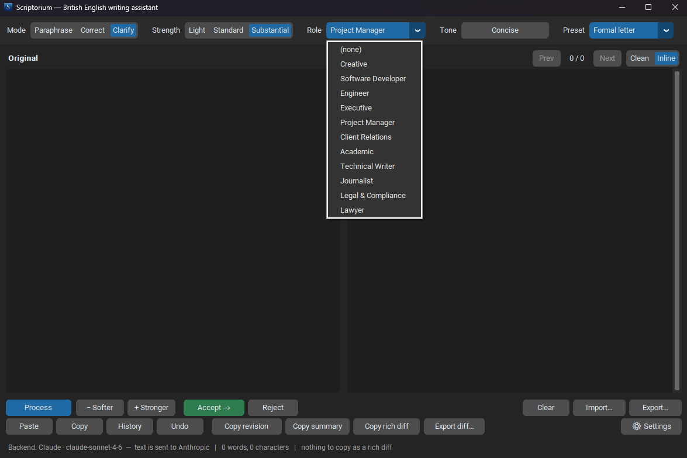

# Scriptorium

[](scriptorium.py)
[](https://www.python.org/downloads/)
[](https://www.microsoft.com/windows)
[](https://github.com/hawkers63/Scriptorium/actions/workflows/ci.yml)
[](https://github.com/hawkers63/Scriptorium/actions/workflows/codeql.yml)
[](LICENSE)

Scriptorium is a lightweight British English writing assistant for Windows 11.
It gives you a focused desktop workspace for revising prose with Claude or a
local Ollama model while keeping every suggested change visible, reviewable,
and under your control.

Built with Python, CustomTkinter, and standard-library HTTP calls, it keeps the
interface calm: original text on the left, a suggested revision on the right,
and just enough controls to tune the rewrite without turning the app into a
prompt laboratory.

---

## Showcase

| Main workspace | Settings |
| --- | --- |
|  |  |

| Toolbar and menus |
| --- |
|  |

> Placeholder: add an animated GIF here showing paste, process, review,
> accept, and copy once a short capture is available.

---

## Why Scriptorium

- **Review-first rewriting** - every revision is shown beside the source text,
  with inline differences and clear accept, reject, undo, copy, import, and
  export controls.
- **British English by design** - user-facing text, spelling, prompts, and
  advisory checks follow British conventions.
- **Choice of backends** - use Claude for stronger rewriting quality or Ollama
  for a fully local workflow.
- **Tone and role steering** - combine editing mode, strength, writing role,
  and up to three bounded tones without allowing the model to invent facts.
- **Meaning-preservation safeguards** - placeholders, names, numbers, URLs,
  quotations, and technical terms are protected or flagged.
- **Windows-native niceties** - optional tray support, start-with-Windows, and
  drag-and-drop import keep it comfortable as a small desktop tool.
- **Private by default** - configuration is local, live API keys are excluded
  from Git, and the repository remains proprietary.

---

## Feature Tour

### Editing Modes

- **Paraphrase** - reword while preserving meaning and tone.
- **Correct** - fix grammar, spelling, punctuation, and usage with minimal
  intervention.
- **Clarify** - improve readability and structure without adding new claims.

### Rewrite Controls

- Strength levels: **Light**, **Standard**, and **Substantial**.
- Writing roles for contexts such as technical writing, client replies,
  project updates, executive communication, legal and compliance material, and
  software development.
- Multi-tone composition with conflict checks, priority ordering, and
  safeguards against embellishment.
- One-click **Softer** and **Stronger** reruns for quick tuning.
- Built-in and user-defined presets for repeatable combinations of mode,
  strength, role, and tones.

### Review And Export

- Side-by-side clean and inline diff views.
- Copy revision, copy summary, accept, reject, and undo.
- Plain text and Markdown import/export.
- Optional Word `.docx` import/export via `python-docx`.
- Optional tray and autostart support via `pystray` and `Pillow`.

---

## Requirements

- Windows 11.
- Python 3.10 or newer.
- `customtkinter`, installed from `requirements.txt`.
- Optional extras:
  - `python-docx` for Word import/export.
  - `pystray` and `Pillow` for tray and start-with-Windows support.
  - Ollama, if you want local model processing.

---

## Installation

Clone the private repository and enter the project folder:

```powershell
git clone https://github.com/hawkers63/Scriptorium.git
cd Scriptorium
```

Create and activate a virtual environment:

```powershell
py -3.11 -m venv .venv
.\.venv\Scripts\Activate.ps1
```

Install the required dependency:

```powershell
python -m pip install --upgrade pip
pip install -r requirements.txt
```

Install optional extras only when you need them:

```powershell
pip install python-docx
pip install pystray pillow
```

---

## Running

Run from source:

```powershell
python scriptorium.py
```

Or double-click:

```text
Scriptorium.bat
```

On first launch, open **Settings** and choose one backend:

- **Claude API** - paste an Anthropic API key or set the
  `ANTHROPIC_API_KEY` environment variable.
- **Ollama** - select the Ollama backend and choose an installed local model.

---

## Configuration

Scriptorium creates `scriptorium_config.json` next to the script when run from
source. The packaged executable stores settings under `%LOCALAPPDATA%`.

Never commit `scriptorium_config.json`. It can contain a live Anthropic API key
in plain text and is intentionally ignored by Git.

To start from the template:

```powershell
copy scriptorium_config.example.json scriptorium_config.json
```

The Claude API key is a pay-as-you-go key from `console.anthropic.com`. It is
separate from a Claude.ai subscription.

---

## Local Ollama Backend

Install Ollama, pull a model, and choose it in Scriptorium settings:

```powershell
ollama pull llama3.1:8b
```

With Ollama running, processing stays on your machine. To store large model
files on another drive, set `OLLAMA_MODELS` before starting Ollama.

---

## Building The Windows App

Install PyInstaller and build from the tracked spec file:

```powershell
pip install pyinstaller
pyinstaller scriptorium.spec
```

The build output is written to `dist\Scriptorium.exe`. Build artefacts and
packaged executables are ignored by Git.

---

## Repository Automation

This repository is prepared for a small but professional maintenance loop:

- **CI** runs focused Python checks and tests on `main` and pull requests.
- **CodeQL** scans Python code for security issues.
- **Dependabot** watches Python and GitHub Actions dependencies.
- **Formatting checks** can be run through the proposed Ruff workflow.
- **Release drafting** can create GitHub releases from pushed version tags once
  Mark approves the workflow.

Workflow changes must be reviewed before they are finalised because this is a
private proprietary repository.

---

## Roadmap

Ongoing product notes live in `ROADMAP.md` and the private notes folder.

Near-term themes:

- Preserve the app's small, single-purpose desktop identity.
- Strengthen rewrite reliability and review clarity.
- Keep roles, tones, and presets useful without turning them into author
  imitation.
- Continue improving Windows polish and repository hygiene.

---

## Security

Do not open public issues containing keys, configuration dumps, local paths, or
private repository details. See `SECURITY.md` for the reporting process.

---

## Copyright

Copyright (c) 2026 Mark Hawksworth. All rights reserved.

Scriptorium is private, proprietary software. Access to the repository does not
grant permission to copy, modify, redistribute, sublicense, or create derivative
works without Mark Hawksworth's prior written consent.

See `LICENSE`, `COPYRIGHT.md`, and `SECURITY.md`.
